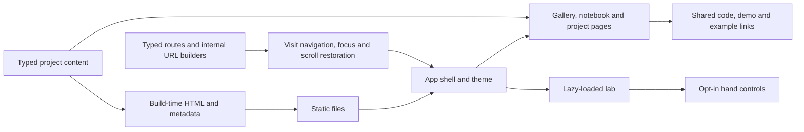

# Portfolio notebook

A personal ML engineering portfolio with an optional introduction, an illustrated project notebook, shareable project pages, and a browser-based source-checking lab.

## Run

Requires Node.js 24 and npm.

```sh
npm ci
npm run dev
```

Open the local URL printed by Vite. Scroll through the project gallery, open a project directly, or choose **Explore my work** to open the notebook. The optional short introduction sits below the gallery. Select a project tab, then **Open the full project** for its technical story and available code/demo links. Work and Contact are always reachable. In the optional **Lab**, choose **Start source check** to focus the source choices; a wrong commit or an unretrieved file is rejected. Gesture controls are optional. Contact shows the email address and a copy action as well as email and LinkedIn links.

The first `dev` or `build` command downloads Google's versioned hand model and verifies its SHA-256. The build copies the installed MediaPipe runtime into ignored local assets. Fonts, the model, and runtime assets are served from the same origin; no camera frames are uploaded. Network access is needed for the initial model download, not for subsequent cached builds.

## What runs

- React and TypeScript render the introduction, six-project notebook, dedicated project pages, About/Contact pages, day/night theme, and lab decision history.
- Three.js renders a procedural machine. It redraws when its state or size changes, pauses offscreen, and respects reduced motion. Text controls remain usable if WebGL is unavailable.
- The companion grows from a seed into a learner and guide as distinct projects are explored during a visit. Revisiting the same project does not increase progress. It does not train a model.
- The co-op bridge pairs one visitor with the local companion, not a remote player. Two tiles require the retrieved file at the right revision; the third requires a claim supported by the local fixture. Day/night mode also changes the illustrated scene, including rain and lamplight.
- Hand tracking runs in a worker after camera opt-in. Pinch and move sideways to change stages. Closing the panel, leaving the lab, hiding the page, or cancelling startup stops camera tracks. Mouse, touch, and keyboard controls remain available.

The machine uses a small local evidence fixture. It does not call an LLM, connect to private repositories, or run the actual projects shown in the portfolio. Project descriptions distinguish employer contributions, team projects, experiments, and work in development.

Tiny Town's previews are captures of its actual interface with a staged mock replay, including day and night views. Galilearn's preview is captured from its coded design prototype and is labelled as a prototype. The portfolio does not ship either project's source code.

## Navigation and layout

On larger screens, scrolling gathers the visible project cards from a gallery into a rotating ring. The gallery shows up to six projects at a time, adding Previous/Next controls when needed. Counts, grid rows and ring angles follow the current project data, including incomplete final pages; new projects without a custom preview use a default illustration. Notebook tabs wrap as the list grows. Cards open their project pages and lift on hover or keyboard focus. The motion uses transforms updated only on scroll/resize; there is no continuous animation loop, scroll interception or extra animation dependency. Phones and reduced-motion mode use a static grid. Work and Contact stay available in the sticky header. Dark mode uses charcoal surfaces with muted rose accents.

The introduction opens into one notebook, with all six project choices visible on phones. `/work/<project-id>` selects a spread, `/project/<project-id>` opens its full page, and `/about`, `/contact`, and `/lab` open the other pages. Browser Back/Forward and reload preserve the URL-selected project. A project opened from the gallery returns to that gallery page and scroll position; one opened from the notebook returns to its spread. Browser Back/Forward restores the invoking project link. The contextual source-check example returns to its originating case study, and case studies provide the next project and a project-specific email link. Unknown pages show a recovery link. The introduction restarts only when explicitly opened or replayed.

The notebook gives a short overview, personal contribution and a design decision. Full project pages add named technical sections covering the problem, implementation and checks, followed by a next project or contact action. Available code/demo/example links appear early in both views. Introduction artwork uses stable project IDs. Gallery cards follow the grid perimeter before rotating so they do not cross through project labels.

Return positions travel with browser history entries, including across a project reload. Route-level and gesture-panel error boundaries contain failed optional downloads while leaving Work and Contact usable. Reloading is the explicit recovery for a failed cached module import.

Implemented architecture:



The build generates HTML for each project and main page, with canonical URLs, descriptions and social metadata. Clean-path HTML files and directory indexes keep direct navigation compatible with static hosts. Client navigation uses browser history; old hash links resolve to the corresponding path. Pages hydrate their generated content; legacy fragments and return queries render the selected state instead. No routing dependency or application server is needed. Set `SITE_URL` when building for another domain; the default is the existing preview origin. Project IDs must be unique lowercase slugs; the build rejects invalid IDs before writing page files.

Typed project data is shared by notebook spreads and project pages. Theme tokens have one definition per mode in `src/styles.css`. Original SVG illustrations and the Lab use cream/graphite/rose accents; actual project captures keep their own colors. Screenshots have 480/960/1440px WebP variants, with context-specific image sizes and the original full-resolution captures retained. A new preview without variants still works through its ordinary image URL. The lab and its 3D code load separately from the entry pages, and camera assets remain opt-in.

## Verify

```sh
npm run check
npx playwright install chromium --only-shell
npm run test:browser
npm audit
```

On Linux, install browser system dependencies with `npx playwright install chromium --with-deps --only-shell`.

Current verification: 21 unit tests and 36 Chromium browser checks pass against the production build, alongside lint and TypeScript. Coverage includes provenance and pinch validation, project reordering, history and reload returns, failed module downloads, ring-label visibility, responsive image selection, clipboard denial, static pages without JavaScript, both themes, automated accessibility, layouts from 320–1440px, permission denial, model startup on a synthetic camera and cleanup after late permission resolution. Real-hand accuracy, device-specific camera behavior, Safari/Firefox and field performance have not been verified.

Browser checks start a production preview automatically after `npm run check`. To use an existing preview on another port, set `PORTFOLIO_BASE_URL` to its local URL when running browser tests. Static-generation checks require a production build rather than the development server.

## Edit

- Project content: `src/data.ts`
- Shared shell and theme: `src/App.tsx`
- Routes, return context and focus/scroll restoration: `src/routes.ts`, `src/usePortfolioNavigation.tsx`
- Static HTML, page metadata and editable share artwork: `scripts/prerender.mjs`, `src/page-metadata.ts`, `public/social/portfolio.svg`
- Shared project actions: `src/ProjectActions.tsx`
- Introduction and notebook: `src/Notebook.tsx`, `src/notebook.css`
- Project pages and original SVG illustrations: `src/ProjectPage.tsx`, `src/ProjectArtwork.tsx`
- Visual tokens and responsive layouts: `src/styles.css`
- Lab task and history: `src/Lab.tsx`, `src/evidence.ts`
- Procedural model: `src/machine-scene.ts`
- Camera lifecycle and inference: `src/HandControls.tsx`, `src/hand.worker.ts`

The site builds to `dist/` for static hosting over HTTPS. No server, API keys, accounts, or analytics are required. Hosting-provider metadata, local planning, generated mockups, debug reports, build output, and downloaded runtime assets are excluded from Git. Required font and library notices ship in `public/licenses/`.
